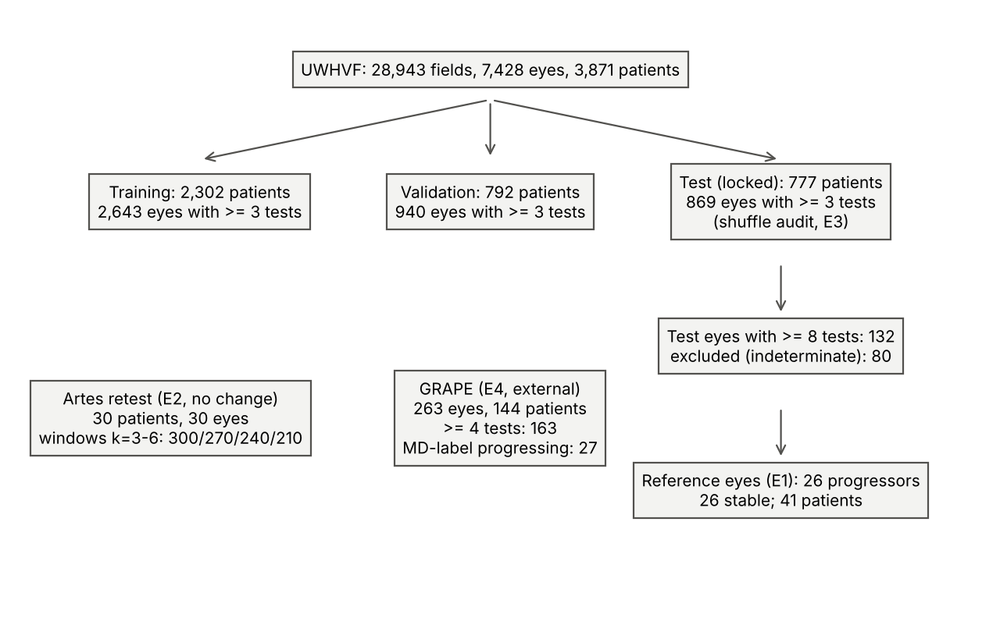

# Supplementary Material

Early Detection of Glaucomatous Visual Field Progression Without False Alarms: A Benchmark With True No-Change Data

## S1. Development history (all ideas tried, including failures)

The benchmark was the third framing of this project. Before it, we developed and tested on validation data only (never the locked test set) the following ideas, each with a hypothesis stated in advance. Full numbers are in the code repository (`journal_selection/novelty_escalation_log.md` and `results/pilot_*.json`, `results/d6_round5.json`).

1. Self-supervised temporal-order network as a learned permutation statistic (round 0): no gain over PoPLR or the mean-sensitivity trend; kept as detector D10.
2. Population-calibrated (pooled-shuffle) null for short series (round 1): valid false alarms, gains only at 3–4 tests; kept as D5.
3. Risk-controlled deferral of visual field tests (round 2): no gain over a simple severity rule; no deferral threshold could be certified.
4. Pooled null against a future reference (round 3): gains only at 3–4 tests, small sample.
5. A different disease area (neovascular AMD, injection rhythm and visual outcome, Moorfields open data; round 4): no added value.
6. Noise-stratified and regional detrended pooled nulls (round 5): the apparent gain at three tests was a false-alarm artefact on true no-change data (Artes); the regional variant is kept as D6.

The Artes retest data were used in round 5 only to check false-alarm rates of development variants. Because several ideas were tried, the benchmark comparisons were pre-registered and corrected for multiple comparisons (Holm), and we make no claim of a new superior method.

## S2. Analysis plan status and deviations

The analysis plan (`experiments/protocol.md`) was time-stamped in version control (commit c0dedb5, 2026-11-23 09:05 UTC) before the final run (results committed 09:33 UTC); it was not deposited in a public registry. A pipeline check in quick mode (models trained on a subset of development data; locked UWHVF test set not used) was run on the Artes and GRAPE data at about 09:08 UTC, before the validity rule in the manuscript draft (09:14 UTC) was written. Deviations from the plan:

1. Validity: the plan said only that the upper confidence limit would be compared with 5%. We report three readings (Methods); the manuscript draft rule (lower ≤5%, upper ≤10%) was written after the pipeline check.
2. RQ2 margin: the plan's hypothesis H2 named a 10-percentage-point margin; with 26 progressors this margin could not be tested with adequate power, and the manuscript reports estimates with confidence intervals instead.
3. Confidence intervals for paired differences were first computed at the eye level; after review they were recomputed with the patient-cluster bootstrap, as the plan specified. The McNemar test treats eyes as independent.
4. GRAPE D5 calibration: the plan named leave-one-patient-out; amendment A2 (before final results) changed this to five-fold patient-level cross-fitting.
5. D8 features: the plan listed example features (MD level/slope/z, PLR counts, PoPLR S, worst region slope, range, SD); the implemented set of 14 features (`tab_features` in `code/src/models/detectors.py`) uses mean sensitivity level, change, slope and its t statistic, pointwise-regression summaries (share of locations with fast significant loss, share with p < 0.05, mean −log p, mean of the worst 10% of slopes, slope SD), test-to-test variability, range, number of tests and follow-up time; it does not include the PoPLR statistic or a regional slope.
6. Pre-specified secondary GRAPE labels (PLR2, PLR3, any) are reported in Table S4 (they had been omitted from the first draft).
7. Post hoc analyses added after review (not in the original plan): future-only reference (Table S3); GRAPE eyes with at least k + 2 visits (Table S4); exact intervals (Table S1); minimum detectable difference; and analyses P1–P3 (Table S5), whose plan and expectations were added to `experiments/protocol.md` before they were run.
8. The bootstrap interval for the shuffle-audit correlation resamples detector × test-number cells, which are not independent; it is approximate.

Note on D4: PoPLR is deterministic for k ≤ 7; its between-seed variation on true no-change data comes only from the random assignment of test dates (amendment A1), which used different random draws for different seeds.

## Supplementary Fig. S1. Participant flow

Numbers from results/descriptives.json. E1–E4: evaluation sets (see Methods).

## Table S1. Seed variability, secondary (PoPLR-based) reference and strict validity

| Tests | Detector | Seed SD of sensitivity, pp | Seed SD of true no-change false alarms, pp | Sensitivity, secondary PoPLR reference, % (95% CI) | Sensitivity, exact 95% CI | Specificity, exact 95% CI | Valid under strict reading (upper limit ≤5%) |
|---|---|---|---|---|---|---|---|
| 3 | D1 OLS-MD | 0.0 | 0.0 | 10.3 (3.4–18.9) | 5/26 (6.6–39.4) | 25/26 (80.4–99.9) | No |
| 3 | D2 MD rate | 0.0 | 0.0 | 24.1 (15.0–33.3) | 10/26 (20.2–59.4) | 24/26 (74.9–99.1) | Yes |
| 3 | D3 PLR-3 | 0.0 | 0.0 | 1.7 (0.0–5.7) | 1/26 (0.1–19.6) | 25/26 (80.4–99.9) | Yes |
| 3 | D4 PoPLR | 0.0 | 0.0 | 0.0 (0.0–0.0) | 0/26 (0.0–13.2) | 26/26 (86.8–100.0) | Yes |
| 3 | D5 Pooled-shuffle conformal | 0.0 | 0.4 | 10.0 (3.3–18.3) | 5/26 (6.6–39.4) | 25/26 (80.4–99.9) | No |
| 3 | D6 Pooled-detrended conformal | 1.7 | 0.7 | 46.2 (33.0–57.9) | 15/26 (36.9–76.6) | 25/26 (80.4–99.9) | No |
| 3 | D7 Event analysis | 0.0 | 0.0 | 0.0 (0.0–0.0) | 0/26 (0.0–13.2) | 26/26 (86.8–100.0) | Yes |
| 3 | D8 ML tabular | 5.0 | 5.1 | 24.1 (15.2–34.2) | 7/26 (11.6–47.8) | 25/26 (80.4–99.9) | No |
| 3 | D9 ML sequence (GRU) | 5.0 | 3.8 | 9.7 (4.1–16.0) | 4/26 (4.4–34.9) | 26/26 (86.8–100.0) | No |
| 3 | D10 Self-supervised order | 0.0 | 0.0 | 0.0 (0.0–0.0) | 0/26 (0.0–13.2) | 26/26 (86.8–100.0) | Yes |
| 4 | D1 OLS-MD | 0.0 | 0.0 | 20.7 (10.5–31.8) | 8/26 (14.3–51.8) | 26/26 (86.8–100.0) | No |
| 4 | D2 MD rate | 0.0 | 0.0 | 12.1 (4.8–20.7) | 6/26 (9.0–43.6) | 25/26 (80.4–99.9) | Yes |
| 4 | D3 PLR-3 | 0.0 | 0.0 | 10.3 (3.4–18.0) | 4/26 (4.4–34.9) | 26/26 (86.8–100.0) | Yes |
| 4 | D4 PoPLR | 0.0 | 0.2 | 8.6 (1.9–15.8) | 1/26 (0.1–19.6) | 26/26 (86.8–100.0) | Yes |
| 4 | D5 Pooled-shuffle conformal | 0.0 | 0.3 | 20.7 (10.5–31.8) | 8/26 (14.3–51.8) | 26/26 (86.8–100.0) | No |
| 4 | D6 Pooled-detrended conformal | 2.1 | 0.4 | 16.6 (8.2–25.4) | 7/26 (11.6–47.8) | 26/26 (86.8–100.0) | No |
| 4 | D7 Event analysis | 0.0 | 0.0 | 13.8 (6.4–23.3) | 6/26 (9.0–43.6) | 26/26 (86.8–100.0) | Yes |
| 4 | D8 ML tabular | 5.0 | 2.3 | 24.8 (14.3–36.1) | 11/26 (23.4–63.1) | 26/26 (86.8–100.0) | No |
| 4 | D9 ML sequence (GRU) | 3.8 | 1.5 | 7.2 (2.5–13.3) | 3/26 (2.4–30.2) | 26/26 (86.8–100.0) | Yes |
| 4 | D10 Self-supervised order | 4.2 | 0.6 | 12.1 (5.3–19.6) | 5/26 (6.6–39.4) | 26/26 (86.8–100.0) | No |
| 5 | D1 OLS-MD | 0.0 | 0.0 | 27.6 (16.7–41.1) | 11/26 (23.4–63.1) | 26/26 (86.8–100.0) | No |
| 5 | D2 MD rate | 0.0 | 0.0 | 13.8 (5.1–24.1) | 6/26 (9.0–43.6) | 26/26 (86.8–100.0) | Yes |
| 5 | D3 PLR-3 | 0.0 | 0.0 | 15.5 (7.1–25.0) | 6/26 (9.0–43.6) | 26/26 (86.8–100.0) | Yes |
| 5 | D4 PoPLR | 0.0 | 0.2 | 24.1 (13.3–37.7) | 10/26 (20.2–59.4) | 26/26 (86.8–100.0) | No |
| 5 | D5 Pooled-shuffle conformal | 0.0 | 0.2 | 27.6 (16.7–41.1) | 11/26 (23.4–63.1) | 26/26 (86.8–100.0) | No |
| 5 | D6 Pooled-detrended conformal | 1.7 | 0.2 | 21.0 (11.3–32.7) | 8/26 (14.3–51.8) | 26/26 (86.8–100.0) | No |
| 5 | D7 Event analysis | 0.0 | 0.0 | 31.0 (18.5–45.3) | 13/26 (29.9–70.1) | 26/26 (86.8–100.0) | Yes |
| 5 | D8 ML tabular | 2.1 | 2.2 | 38.3 (26.2–51.9) | 14/26 (33.4–73.4) | 26/26 (86.8–100.0) | No |
| 5 | D9 ML sequence (GRU) | 8.9 | 4.1 | 25.9 (15.3–37.5) | 11/26 (23.4–63.1) | 24/26 (74.9–99.1) | No |
| 5 | D10 Self-supervised order | 3.4 | 0.3 | 27.9 (17.5–40.3) | 13/26 (29.9–70.1) | 26/26 (86.8–100.0) | No |
| 6 | D1 OLS-MD | 0.0 | 0.0 | 37.9 (24.2–51.8) | 15/26 (36.9–76.6) | 26/26 (86.8–100.0) | No |
| 6 | D2 MD rate | 0.0 | 0.0 | 15.5 (7.1–24.6) | 6/26 (9.0–43.6) | 26/26 (86.8–100.0) | Yes |
| 6 | D3 PLR-3 | 0.0 | 0.0 | 15.5 (5.8–26.8) | 6/26 (9.0–43.6) | 26/26 (86.8–100.0) | Yes |
| 6 | D4 PoPLR | 0.0 | 0.2 | 36.2 (22.6–50.0) | 13/26 (29.9–70.1) | 26/26 (86.8–100.0) | No |
| 6 | D5 Pooled-shuffle conformal | 1.7 | 0.2 | 37.6 (24.1–51.3) | 15/26 (36.9–76.6) | 26/26 (86.8–100.0) | No |
| 6 | D6 Pooled-detrended conformal | 0.0 | 0.4 | 43.1 (29.8–55.7) | 14/26 (33.4–73.4) | 26/26 (86.8–100.0) | No |
| 6 | D7 Event analysis | 0.0 | 0.0 | 39.7 (25.0–55.4) | 15/26 (36.9–76.6) | 26/26 (86.8–100.0) | Yes |
| 6 | D8 ML tabular | 3.4 | 0.7 | 42.1 (29.8–54.8) | 18/26 (48.2–85.7) | 26/26 (86.8–100.0) | No |
| 6 | D9 ML sequence (GRU) | 13.2 | 4.2 | 21.0 (12.5–30.3) | 12/26 (26.6–66.6) | 24/26 (74.9–99.1) | No |
| 6 | D10 Self-supervised order | 3.2 | 0.5 | 43.1 (30.3–56.6) | 15/26 (36.9–76.6) | 26/26 (86.8–100.0) | No |

## Table S2. All paired comparisons with D1 (exact McNemar test, Holm correction within each number of tests and endpoint)

| Tests | Endpoint | Detector | n | Difference vs D1, pp (95% CI) | Only detector / only D1 | McNemar p | Holm p |
|---|---|---|---|---|---|---|---|
| 3 | sensitivity | D10 Self-supervised order | 26 | -19.2 (-33.3 to -7.4) | 0 / 5 | 0.062 | 0.50 |
| 3 | sensitivity | D2 MD rate | 26 | +19.2 (-3.4 to 41.7) | 7 / 2 | 0.18 | 0.72 |
| 3 | sensitivity | D3 PLR-3 | 26 | -15.4 (-28.6 to -4.0) | 0 / 4 | 0.12 | 0.62 |
| 3 | sensitivity | D4 PoPLR | 26 | -19.2 (-33.3 to -7.4) | 0 / 5 | 0.062 | 0.50 |
| 3 | sensitivity | D5 Pooled-shuffle conformal | 26 | +0.0 (0.0 to 0.0) | 0 / 0 | 1.00 | 1.00 |
| 3 | sensitivity | D6 Pooled-detrended conformal | 26 | +38.5 (19.4 to 57.7) | 10 / 0 | 0.002 | 0.018 |
| 3 | sensitivity | D7 Event analysis | 26 | -19.2 (-33.3 to -7.4) | 0 / 5 | 0.062 | 0.50 |
| 3 | sensitivity | D8 ML tabular | 26 | +7.7 (-10.3 to 26.9) | 4 / 2 | 0.69 | 1.00 |
| 3 | sensitivity | D9 ML sequence (GRU) | 26 | -3.8 (-23.1 to 16.7) | 3 / 4 | 1.00 | 1.00 |
| 3 | false positives (1-spec) | D10 Self-supervised order | 26 | -3.8 (-13.0 to 0.0) | 0 / 1 | 1.00 | 1.00 |
| 3 | false positives (1-spec) | D2 MD rate | 26 | +3.8 (0.0 to 12.5) | 1 / 0 | 1.00 | 1.00 |
| 3 | false positives (1-spec) | D3 PLR-3 | 26 | +0.0 (-12.0 to 10.4) | 1 / 1 | 1.00 | 1.00 |
| 3 | false positives (1-spec) | D4 PoPLR | 26 | -3.8 (-13.0 to 0.0) | 0 / 1 | 1.00 | 1.00 |
| 3 | false positives (1-spec) | D5 Pooled-shuffle conformal | 26 | +0.0 (0.0 to 0.0) | 0 / 0 | 1.00 | 1.00 |
| 3 | false positives (1-spec) | D6 Pooled-detrended conformal | 26 | +0.0 (0.0 to 0.0) | 0 / 0 | 1.00 | 1.00 |
| 3 | false positives (1-spec) | D7 Event analysis | 26 | -3.8 (-13.0 to 0.0) | 0 / 1 | 1.00 | 1.00 |
| 3 | false positives (1-spec) | D8 ML tabular | 26 | +0.0 (0.0 to 0.0) | 0 / 0 | 1.00 | 1.00 |
| 3 | false positives (1-spec) | D9 ML sequence (GRU) | 26 | -3.8 (-13.0 to 0.0) | 0 / 1 | 1.00 | 1.00 |
| 3 | GRAPE sensitivity | D2 MD rate | 27 | +14.8 (-7.8 to 37.0) | 8 / 4 | 0.39 | 0.78 |
| 3 | GRAPE sensitivity | D3 PLR-3 | 27 | -40.7 (-61.5 to -19.2) | 1 / 12 | 0.003 | 0.014 |
| 3 | GRAPE sensitivity | D4 PoPLR | 27 | -44.4 (-65.4 to -25.9) | 0 / 12 | <0.001 | 0.003 |
| 3 | GRAPE sensitivity | D5 Pooled-shuffle conformal | 27 | -3.7 (-11.5 to 0.0) | 0 / 1 | 1.00 | 1.00 |
| 3 | GRAPE sensitivity | D7 Event analysis | 27 | -44.4 (-65.4 to -25.9) | 0 / 12 | <0.001 | 0.003 |
| 3 | GRAPE sensitivity | D8 ML tabular | 27 | +25.9 (0.0 to 50.0) | 10 / 3 | 0.092 | 0.28 |
| 3 | GRAPE false positives | D2 MD rate | 236 | +16.5 (11.0 to 22.2) | 44 / 5 | <0.001 | <0.001 |
| 3 | GRAPE false positives | D3 PLR-3 | 236 | -0.4 (-4.2 to 3.3) | 7 / 8 | 1.00 | 1.00 |
| 3 | GRAPE false positives | D4 PoPLR | 236 | -4.7 (-7.8 to -2.1) | 0 / 11 | <0.001 | 0.004 |
| 3 | GRAPE false positives | D5 Pooled-shuffle conformal | 236 | +0.0 (0.0 to 0.0) | 0 / 0 | 1.00 | 1.00 |
| 3 | GRAPE false positives | D7 Event analysis | 236 | -4.7 (-7.8 to -2.1) | 0 / 11 | <0.001 | 0.004 |
| 3 | GRAPE false positives | D8 ML tabular | 236 | +33.5 (27.4 to 40.3) | 79 / 0 | <0.001 | <0.001 |
| 4 | sensitivity | D10 Self-supervised order | 26 | -11.5 (-28.0 to 4.0) | 1 / 4 | 0.38 | 1.00 |
| 4 | sensitivity | D2 MD rate | 26 | -7.7 (-23.1 to 7.1) | 1 / 3 | 0.62 | 1.00 |
| 4 | sensitivity | D3 PLR-3 | 26 | -15.4 (-33.3 to 0.0) | 1 / 5 | 0.22 | 1.00 |
| 4 | sensitivity | D4 PoPLR | 26 | -26.9 (-44.0 to -11.1) | 0 / 7 | 0.016 | 0.14 |
| 4 | sensitivity | D5 Pooled-shuffle conformal | 26 | +0.0 (0.0 to 0.0) | 0 / 0 | 1.00 | 1.00 |
| 4 | sensitivity | D6 Pooled-detrended conformal | 26 | -3.8 (-16.0 to 8.3) | 1 / 2 | 1.00 | 1.00 |
| 4 | sensitivity | D7 Event analysis | 26 | -7.7 (-26.9 to 11.1) | 2 / 4 | 0.69 | 1.00 |
| 4 | sensitivity | D8 ML tabular | 26 | +11.5 (-7.4 to 30.8) | 4 / 1 | 0.38 | 1.00 |
| 4 | sensitivity | D9 ML sequence (GRU) | 26 | -19.2 (-40.7 to 3.9) | 2 / 7 | 0.18 | 1.00 |
| 4 | false positives (1-spec) | D10 Self-supervised order | 26 | +0.0 (0.0 to 0.0) | 0 / 0 | 1.00 | 1.00 |
| 4 | false positives (1-spec) | D2 MD rate | 26 | +3.8 (0.0 to 12.5) | 1 / 0 | 1.00 | 1.00 |
| 4 | false positives (1-spec) | D3 PLR-3 | 26 | +0.0 (0.0 to 0.0) | 0 / 0 | 1.00 | 1.00 |
| 4 | false positives (1-spec) | D4 PoPLR | 26 | +0.0 (0.0 to 0.0) | 0 / 0 | 1.00 | 1.00 |
| 4 | false positives (1-spec) | D5 Pooled-shuffle conformal | 26 | +0.0 (0.0 to 0.0) | 0 / 0 | 1.00 | 1.00 |
| 4 | false positives (1-spec) | D6 Pooled-detrended conformal | 26 | +0.0 (0.0 to 0.0) | 0 / 0 | 1.00 | 1.00 |
| 4 | false positives (1-spec) | D7 Event analysis | 26 | +0.0 (0.0 to 0.0) | 0 / 0 | 1.00 | 1.00 |
| 4 | false positives (1-spec) | D8 ML tabular | 26 | +0.0 (0.0 to 0.0) | 0 / 0 | 1.00 | 1.00 |
| 4 | false positives (1-spec) | D9 ML sequence (GRU) | 26 | +0.0 (0.0 to 0.0) | 0 / 0 | 1.00 | 1.00 |
| 4 | GRAPE sensitivity | D2 MD rate | 18 | +22.2 (-5.9 to 52.9) | 6 / 2 | 0.29 | 1.00 |
| 4 | GRAPE sensitivity | D3 PLR-3 | 18 | -22.2 (-42.2 to -5.3) | 0 / 4 | 0.12 | 0.75 |
| 4 | GRAPE sensitivity | D4 PoPLR | 18 | -11.1 (-27.8 to 0.0) | 0 / 2 | 0.50 | 1.00 |
| 4 | GRAPE sensitivity | D5 Pooled-shuffle conformal | 18 | +0.0 (0.0 to 0.0) | 0 / 0 | 1.00 | 1.00 |
| 4 | GRAPE sensitivity | D7 Event analysis | 18 | -16.7 (-44.4 to 10.5) | 2 / 5 | 0.45 | 1.00 |
| 4 | GRAPE sensitivity | D8 ML tabular | 18 | +16.7 (-5.6 to 41.2) | 4 / 1 | 0.38 | 1.00 |
| 4 | GRAPE false positives | D2 MD rate | 145 | +9.7 (4.0 to 16.1) | 16 / 2 | 0.001 | 0.007 |
| 4 | GRAPE false positives | D3 PLR-3 | 145 | -2.1 (-6.2 to 2.0) | 3 / 6 | 0.51 | 1.00 |
| 4 | GRAPE false positives | D4 PoPLR | 145 | +0.7 (-3.6 to 5.1) | 6 / 5 | 1.00 | 1.00 |
| 4 | GRAPE false positives | D5 Pooled-shuffle conformal | 145 | +1.4 (0.0 to 3.5) | 2 / 0 | 0.50 | 1.00 |
| 4 | GRAPE false positives | D7 Event analysis | 145 | +0.0 (-4.8 to 4.8) | 6 / 6 | 1.00 | 1.00 |
| 4 | GRAPE false positives | D8 ML tabular | 145 | +14.5 (8.5 to 21.4) | 21 / 0 | <0.001 | <0.001 |
| 5 | sensitivity | D10 Self-supervised order | 26 | +7.7 (-7.4 to 22.2) | 3 / 1 | 0.62 | 1.00 |
| 5 | sensitivity | D2 MD rate | 26 | -19.2 (-36.0 to -4.0) | 1 / 6 | 0.12 | 1.00 |
| 5 | sensitivity | D3 PLR-3 | 26 | -19.2 (-33.3 to -4.3) | 0 / 5 | 0.062 | 0.56 |
| 5 | sensitivity | D4 PoPLR | 26 | -3.8 (-12.0 to 0.0) | 0 / 1 | 1.00 | 1.00 |
| 5 | sensitivity | D5 Pooled-shuffle conformal | 26 | +0.0 (0.0 to 0.0) | 0 / 0 | 1.00 | 1.00 |
| 5 | sensitivity | D6 Pooled-detrended conformal | 26 | -11.5 (-33.4 to 8.3) | 2 / 5 | 0.45 | 1.00 |
| 5 | sensitivity | D7 Event analysis | 26 | +7.7 (-10.3 to 26.1) | 4 / 2 | 0.69 | 1.00 |
| 5 | sensitivity | D8 ML tabular | 26 | +11.5 (0.0 to 25.0) | 3 / 0 | 0.25 | 1.00 |
| 5 | sensitivity | D9 ML sequence (GRU) | 26 | +0.0 (-20.8 to 20.8) | 5 / 5 | 1.00 | 1.00 |
| 5 | false positives (1-spec) | D10 Self-supervised order | 26 | +0.0 (0.0 to 0.0) | 0 / 0 | 1.00 | 1.00 |
| 5 | false positives (1-spec) | D2 MD rate | 26 | +0.0 (0.0 to 0.0) | 0 / 0 | 1.00 | 1.00 |
| 5 | false positives (1-spec) | D3 PLR-3 | 26 | +0.0 (0.0 to 0.0) | 0 / 0 | 1.00 | 1.00 |
| 5 | false positives (1-spec) | D4 PoPLR | 26 | +0.0 (0.0 to 0.0) | 0 / 0 | 1.00 | 1.00 |
| 5 | false positives (1-spec) | D5 Pooled-shuffle conformal | 26 | +0.0 (0.0 to 0.0) | 0 / 0 | 1.00 | 1.00 |
| 5 | false positives (1-spec) | D6 Pooled-detrended conformal | 26 | +0.0 (0.0 to 0.0) | 0 / 0 | 1.00 | 1.00 |
| 5 | false positives (1-spec) | D7 Event analysis | 26 | +0.0 (0.0 to 0.0) | 0 / 0 | 1.00 | 1.00 |
| 5 | false positives (1-spec) | D8 ML tabular | 26 | +0.0 (0.0 to 0.0) | 0 / 0 | 1.00 | 1.00 |
| 5 | false positives (1-spec) | D9 ML sequence (GRU) | 26 | +7.7 (0.0 to 24.0) | 2 / 0 | 0.50 | 1.00 |
| 6 | sensitivity | D10 Self-supervised order | 26 | +0.0 (-19.2 to 17.9) | 3 / 3 | 1.00 | 1.00 |
| 6 | sensitivity | D2 MD rate | 26 | -34.6 (-54.2 to -18.5) | 1 / 10 | 0.012 | 0.094 |
| 6 | sensitivity | D3 PLR-3 | 26 | -34.6 (-53.8 to -16.0) | 0 / 9 | 0.004 | 0.035 |
| 6 | sensitivity | D4 PoPLR | 26 | -7.7 (-26.9 to 10.3) | 2 / 4 | 0.69 | 1.00 |
| 6 | sensitivity | D5 Pooled-shuffle conformal | 26 | +0.0 (0.0 to 0.0) | 0 / 0 | 1.00 | 1.00 |
| 6 | sensitivity | D6 Pooled-detrended conformal | 26 | -3.8 (-20.0 to 12.0) | 2 / 3 | 1.00 | 1.00 |
| 6 | sensitivity | D7 Event analysis | 26 | +0.0 (-20.0 to 17.9) | 3 / 3 | 1.00 | 1.00 |
| 6 | sensitivity | D8 ML tabular | 26 | +11.5 (-8.0 to 30.4) | 5 / 2 | 0.45 | 1.00 |
| 6 | sensitivity | D9 ML sequence (GRU) | 26 | -11.5 (-34.6 to 12.5) | 4 / 7 | 0.55 | 1.00 |
| 6 | false positives (1-spec) | D10 Self-supervised order | 26 | +0.0 (0.0 to 0.0) | 0 / 0 | 1.00 | 1.00 |
| 6 | false positives (1-spec) | D2 MD rate | 26 | +0.0 (0.0 to 0.0) | 0 / 0 | 1.00 | 1.00 |
| 6 | false positives (1-spec) | D3 PLR-3 | 26 | +0.0 (0.0 to 0.0) | 0 / 0 | 1.00 | 1.00 |
| 6 | false positives (1-spec) | D4 PoPLR | 26 | +0.0 (0.0 to 0.0) | 0 / 0 | 1.00 | 1.00 |
| 6 | false positives (1-spec) | D5 Pooled-shuffle conformal | 26 | +0.0 (0.0 to 0.0) | 0 / 0 | 1.00 | 1.00 |
| 6 | false positives (1-spec) | D6 Pooled-detrended conformal | 26 | +0.0 (0.0 to 0.0) | 0 / 0 | 1.00 | 1.00 |
| 6 | false positives (1-spec) | D7 Event analysis | 26 | +0.0 (0.0 to 0.0) | 0 / 0 | 1.00 | 1.00 |
| 6 | false positives (1-spec) | D8 ML tabular | 26 | +0.0 (0.0 to 0.0) | 0 / 0 | 1.00 | 1.00 |
| 6 | false positives (1-spec) | D9 ML sequence (GRU) | 26 | +7.7 (0.0 to 24.0) | 2 / 0 | 0.50 | 1.00 |

pp, percentage points. Paired comparisons use the majority flag over seeds for stochastic detectors.

## Table S3. Post hoc future-only reference (UWHVF test set; reference computed only from tests after the first k, at least five later tests)

3 tests: 132 eyes, 17 progressors, 32 stable (p > 0.5), 99 with no evidence of progression; 4 tests: 104 eyes, 14 progressors, 25 stable (p > 0.5), 80 with no evidence of progression; 5 tests: 76 eyes, 6 progressors, 24 stable (p > 0.5), 60 with no evidence of progression; 6 tests: 62 eyes, 5 progressors, 24 stable (p > 0.5), 51 with no evidence of progression.

| Tests | Detector | Sensitivity, % (95% CI) | Specificity, stable = p > 0.5, % (95% CI) | Specificity, stable = no evidence of progression, % (95% CI) |
|---|---|---|---|---|
| 3 | D1 OLS-MD | 5.9 (0.0–18.8) | 94.4 (82.4–100.0) | 90.4 (81.2–98.0) |
| 3 | D2 MD rate | 17.6 (0.0–35.3) | 88.9 (72.2–100.0) | 84.6 (74.5–93.8) |
| 3 | D3 PLR-3 | 0.0 (0.0–0.0) | 100.0 (100.0–100.0) | 96.2 (90.2–100.0) |
| 3 | D4 PoPLR | 0.0 (0.0–0.0) | 100.0 (100.0–100.0) | 100.0 (100.0–100.0) |
| 3 | D5 Pooled-shuffle conformal | 5.9 (0.0–18.8) | 94.4 (82.4–100.0) | 90.4 (81.2–98.0) |
| 3 | D6 Pooled-detrended conformal | 52.9 (31.2–75.0) | 83.3 (62.5–100.0) | 75.0 (63.0–85.5) |
| 3 | D7 Event analysis | 0.0 (0.0–0.0) | 100.0 (100.0–100.0) | 100.0 (100.0–100.0) |
| 3 | D8 ML tabular | 17.6 (0.0–37.5) | 83.3 (63.1–100.0) | 84.6 (74.1–93.9) |
| 3 | D9 ML sequence (GRU) | 5.9 (0.0–18.8) | 100.0 (100.0–100.0) | 94.2 (87.2–100.0) |
| 3 | D10 Self-supervised order | 0.0 (0.0–0.0) | 100.0 (100.0–100.0) | 100.0 (100.0–100.0) |
| 4 | D1 OLS-MD | 21.4 (0.0–46.2) | 92.3 (72.7–100.0) | 90.2 (81.2–97.9) |
| 4 | D2 MD rate | 7.1 (0.0–23.1) | 92.3 (72.7–100.0) | 90.2 (81.5–97.9) |
| 4 | D3 PLR-3 | 21.4 (0.0–41.2) | 100.0 (100.0–100.0) | 94.1 (86.5–100.0) |
| 4 | D4 PoPLR | 7.1 (0.0–23.1) | 100.0 (100.0–100.0) | 96.1 (89.8–100.0) |
| 4 | D5 Pooled-shuffle conformal | 21.4 (0.0–46.2) | 92.3 (72.7–100.0) | 90.2 (81.2–97.9) |
| 4 | D6 Pooled-detrended conformal | 21.4 (0.0–41.2) | 92.3 (72.7–100.0) | 90.2 (80.9–98.0) |
| 4 | D7 Event analysis | 7.1 (0.0–23.1) | 92.3 (72.7–100.0) | 88.2 (78.8–96.1) |
| 4 | D8 ML tabular | 21.4 (0.0–42.9) | 84.6 (61.5–100.0) | 86.3 (75.5–94.7) |
| 4 | D9 ML sequence (GRU) | 7.1 (0.0–23.1) | 92.3 (75.0–100.0) | 94.1 (87.0–100.0) |
| 4 | D10 Self-supervised order | 14.3 (0.0–31.3) | 100.0 (100.0–100.0) | 96.1 (90.2–100.0) |
| 5 | D1 OLS-MD | 33.3 (0.0–66.7) | 85.7 (64.3–100.0) | 86.0 (75.0–95.2) |
| 5 | D2 MD rate | 16.7 (0.0–50.0) | 92.9 (75.0–100.0) | 93.0 (84.1–100.0) |
| 5 | D3 PLR-3 | 33.3 (0.0–66.7) | 85.7 (64.3–100.0) | 90.7 (81.0–97.8) |
| 5 | D4 PoPLR | 33.3 (0.0–66.7) | 85.7 (64.3–100.0) | 86.0 (75.0–95.2) |
| 5 | D5 Pooled-shuffle conformal | 33.3 (0.0–66.7) | 85.7 (64.3–100.0) | 86.0 (75.0–95.2) |
| 5 | D6 Pooled-detrended conformal | 16.7 (0.0–50.0) | 85.7 (64.3–100.0) | 83.7 (72.1–93.2) |
| 5 | D7 Event analysis | 33.3 (0.0–66.7) | 78.6 (53.8–100.0) | 76.7 (61.4–90.2) |
| 5 | D8 ML tabular | 50.0 (16.7–83.3) | 71.4 (42.9–93.8) | 74.4 (59.1–87.2) |
| 5 | D9 ML sequence (GRU) | 50.0 (16.7–83.3) | 78.6 (50.0–100.0) | 83.7 (70.5–95.2) |
| 5 | D10 Self-supervised order | 50.0 (16.7–83.3) | 78.6 (53.8–100.0) | 81.4 (68.3–91.5) |
| 6 | D1 OLS-MD | 25.0 (0.0–75.0) | 75.0 (50.0–94.1) | 69.2 (51.3–86.5) |
| 6 | D2 MD rate | 0.0 (0.0–0.0) | 75.0 (50.0–94.1) | 84.6 (72.7–94.7) |
| 6 | D3 PLR-3 | 0.0 (0.0–0.0) | 87.5 (66.7–100.0) | 87.2 (73.5–97.6) |
| 6 | D4 PoPLR | 25.0 (0.0–75.0) | 75.0 (53.3–93.8) | 71.8 (56.8–85.4) |
| 6 | D5 Pooled-shuffle conformal | 25.0 (0.0–75.0) | 75.0 (50.0–94.1) | 69.2 (51.3–86.5) |
| 6 | D6 Pooled-detrended conformal | 50.0 (0.0–100.0) | 62.5 (35.3–87.5) | 64.1 (48.6–79.5) |
| 6 | D7 Event analysis | 50.0 (0.0–100.0) | 68.8 (42.9–88.9) | 66.7 (48.7–83.8) |
| 6 | D8 ML tabular | 75.0 (25.0–100.0) | 62.5 (40.0–83.3) | 69.2 (52.5–85.3) |
| 6 | D9 ML sequence (GRU) | 25.0 (0.0–75.0) | 68.8 (41.2–93.3) | 79.5 (63.4–92.9) |
| 6 | D10 Self-supervised order | 50.0 (0.0–100.0) | 62.5 (35.7–87.5) | 64.1 (47.5–81.1) |

Patient-cluster bootstrap 95% CIs. Progressor: later-test slope of mean total deviation < −0.3 dB/year with one-sided p < 0.01.

## Table S4. GRAPE by label and by number of visits (post hoc restriction; secondary labels pre-specified)

| Tests | Detector | Label | Eyes ≥ k+2 visits only | n (positive) | Sensitivity, % (95% CI) | Specificity, % (95% CI) |
|---|---|---|---|---|---|---|
| 3 | D1 OLS-MD | MD | no | 263 (27) | 44.4 (25.9–65.4) | 95.3 (92.2–97.9) |
| 3 | D1 OLS-MD | PLR2 | no | 263 (40) | 17.5 (7.0–30.0) | 92.8 (88.5–96.4) |
| 3 | D1 OLS-MD | PLR3 | no | 263 (14) | 21.4 (0.0–41.2) | 92.0 (88.2–95.4) |
| 3 | D1 OLS-MD | any | no | 263 (54) | 31.5 (19.6–43.4) | 97.1 (94.3–99.5) |
| 3 | D1 OLS-MD | MD | yes | 88 (13) | 23.1 (0.0–50.0) | 93.3 (86.1–98.7) |
| 3 | D1 OLS-MD | PLR2 | yes | 88 (20) | 10.0 (0.0–23.8) | 91.2 (82.2–98.4) |
| 3 | D1 OLS-MD | PLR3 | yes | 88 (9) | 11.1 (0.0–27.3) | 91.1 (83.3–97.4) |
| 3 | D1 OLS-MD | any | yes | 88 (23) | 17.4 (4.3–32.1) | 93.8 (85.9–100.0) |
| 4 | D1 OLS-MD | MD | no | 163 (18) | 33.3 (11.8–55.0) | 95.9 (92.2–98.6) |
| 4 | D1 OLS-MD | PLR2 | no | 163 (31) | 16.1 (3.2–31.2) | 94.7 (90.8–97.9) |
| 4 | D1 OLS-MD | PLR3 | no | 163 (12) | 16.7 (0.0–41.7) | 93.4 (88.7–97.4) |
| 4 | D1 OLS-MD | any | no | 163 (36) | 19.4 (5.9–34.2) | 96.1 (92.6–99.2) |
| 4 | D1 OLS-MD | MD | yes | 50 (11) | 18.2 (0.0–40.0) | 97.4 (91.4–100.0) |
| 4 | D1 OLS-MD | PLR2 | yes | 50 (13) | 7.7 (0.0–21.4) | 94.6 (85.3–100.0) |
| 4 | D1 OLS-MD | PLR3 | yes | 50 (7) | 14.3 (0.0–50.0) | 95.3 (87.8–100.0) |
| 4 | D1 OLS-MD | any | yes | 50 (16) | 12.5 (0.0–26.4) | 97.1 (90.0–100.0) |
| 3 | D2 MD rate | MD | no | 263 (27) | 59.3 (40.7–76.9) | 78.8 (73.5–83.9) |
| 3 | D2 MD rate | PLR2 | no | 263 (40) | 45.0 (30.8–58.5) | 78.5 (72.4–84.1) |
| 3 | D2 MD rate | PLR3 | no | 263 (14) | 57.1 (30.8–80.0) | 76.7 (71.0–82.2) |
| 3 | D2 MD rate | any | no | 263 (54) | 51.9 (39.3–64.2) | 81.8 (76.5–86.9) |
| 3 | D2 MD rate | MD | yes | 88 (13) | 46.2 (21.4–75.0) | 77.3 (65.8–87.3) |
| 3 | D2 MD rate | PLR2 | yes | 88 (20) | 35.0 (16.7–52.6) | 76.5 (65.3–86.6) |
| 3 | D2 MD rate | PLR3 | yes | 88 (9) | 44.4 (12.5–75.0) | 75.9 (64.9–85.7) |
| 3 | D2 MD rate | any | yes | 88 (23) | 39.1 (21.7–57.1) | 78.5 (67.2–88.7) |
| 4 | D2 MD rate | MD | no | 163 (18) | 55.6 (35.3–76.5) | 86.2 (79.4–92.1) |
| 4 | D2 MD rate | PLR2 | no | 163 (31) | 38.7 (22.2–58.1) | 86.4 (80.3–91.9) |
| 4 | D2 MD rate | PLR3 | no | 163 (12) | 50.0 (23.1–81.8) | 84.1 (77.9–89.5) |
| 4 | D2 MD rate | any | no | 163 (36) | 44.4 (28.6–60.0) | 89.0 (83.3–94.3) |
| 4 | D2 MD rate | MD | yes | 50 (11) | 54.5 (27.3–81.8) | 87.2 (74.4–97.5) |
| 4 | D2 MD rate | PLR2 | yes | 50 (13) | 30.8 (8.3–53.3) | 81.1 (65.7–92.7) |
| 4 | D2 MD rate | PLR3 | yes | 50 (7) | 42.9 (11.1–83.3) | 81.4 (67.4–93.3) |
| 4 | D2 MD rate | any | yes | 50 (16) | 43.8 (23.5–66.7) | 88.2 (75.8–97.2) |
| 3 | D3 PLR-3 | MD | no | 263 (27) | 3.7 (0.0–11.5) | 95.8 (92.7–98.3) |
| 3 | D3 PLR-3 | PLR2 | no | 263 (40) | 17.5 (5.1–31.0) | 98.2 (96.3–99.6) |
| 3 | D3 PLR-3 | PLR3 | no | 263 (14) | 28.6 (7.7–50.0) | 97.2 (94.7–99.2) |
| 3 | D3 PLR-3 | any | no | 263 (54) | 13.0 (3.8–23.7) | 98.1 (96.2–99.5) |
| 3 | D3 PLR-3 | MD | yes | 88 (13) | 0.0 (0.0–0.0) | 93.3 (86.5–98.7) |
| 3 | D3 PLR-3 | PLR2 | yes | 88 (20) | 10.0 (0.0–25.0) | 95.6 (90.1–100.0) |
| 3 | D3 PLR-3 | PLR3 | yes | 88 (9) | 11.1 (0.0–27.3) | 94.9 (88.5–100.0) |
| 3 | D3 PLR-3 | any | yes | 88 (23) | 8.7 (0.0–20.8) | 95.4 (89.4–100.0) |
| 4 | D3 PLR-3 | MD | no | 163 (18) | 11.1 (0.0–25.0) | 97.9 (95.2–100.0) |
| 4 | D3 PLR-3 | PLR2 | no | 163 (31) | 16.1 (3.7–28.1) | 100.0 (100.0–100.0) |
| 4 | D3 PLR-3 | PLR3 | no | 163 (12) | 33.3 (7.7–63.6) | 99.3 (98.0–100.0) |
| 4 | D3 PLR-3 | any | no | 163 (36) | 13.9 (5.3–25.6) | 100.0 (100.0–100.0) |
| 4 | D3 PLR-3 | MD | yes | 50 (11) | 9.1 (0.0–23.1) | 100.0 (100.0–100.0) |
| 4 | D3 PLR-3 | PLR2 | yes | 50 (13) | 7.7 (0.0–21.4) | 100.0 (100.0–100.0) |
| 4 | D3 PLR-3 | PLR3 | yes | 50 (7) | 14.3 (0.0–50.0) | 100.0 (100.0–100.0) |
| 4 | D3 PLR-3 | any | yes | 50 (16) | 6.2 (0.0–18.8) | 100.0 (100.0–100.0) |
| 3 | D4 PoPLR | MD | no | 263 (27) | 0.0 (0.0–0.0) | 100.0 (100.0–100.0) |
| 3 | D4 PoPLR | PLR2 | no | 263 (40) | 0.0 (0.0–0.0) | 100.0 (100.0–100.0) |
| 3 | D4 PoPLR | PLR3 | no | 263 (14) | 0.0 (0.0–0.0) | 100.0 (100.0–100.0) |
| 3 | D4 PoPLR | any | no | 263 (54) | 0.0 (0.0–0.0) | 100.0 (100.0–100.0) |
| 3 | D4 PoPLR | MD | yes | 88 (13) | 0.0 (0.0–0.0) | 100.0 (100.0–100.0) |
| 3 | D4 PoPLR | PLR2 | yes | 88 (20) | 0.0 (0.0–0.0) | 100.0 (100.0–100.0) |
| 3 | D4 PoPLR | PLR3 | yes | 88 (9) | 0.0 (0.0–0.0) | 100.0 (100.0–100.0) |
| 3 | D4 PoPLR | any | yes | 88 (23) | 0.0 (0.0–0.0) | 100.0 (100.0–100.0) |
| 4 | D4 PoPLR | MD | no | 163 (18) | 22.2 (5.9–41.2) | 95.2 (91.4–98.0) |
| 4 | D4 PoPLR | PLR2 | no | 163 (31) | 22.6 (9.7–36.7) | 97.0 (93.9–99.3) |
| 4 | D4 PoPLR | PLR3 | no | 163 (12) | 33.3 (7.7–63.6) | 95.4 (91.8–98.1) |
| 4 | D4 PoPLR | any | no | 163 (36) | 19.4 (8.3–32.4) | 96.9 (93.7–99.2) |
| 4 | D4 PoPLR | MD | yes | 50 (11) | 9.1 (0.0–23.1) | 100.0 (100.0–100.0) |
| 4 | D4 PoPLR | PLR2 | yes | 50 (13) | 7.7 (0.0–21.4) | 100.0 (100.0–100.0) |
| 4 | D4 PoPLR | PLR3 | yes | 50 (7) | 14.3 (0.0–50.0) | 100.0 (100.0–100.0) |
| 4 | D4 PoPLR | any | yes | 50 (16) | 6.2 (0.0–18.8) | 100.0 (100.0–100.0) |
| 3 | D5 Pooled-shuffle conformal | MD | no | 263 (27) | 40.7 (23.1–59.3) | 95.3 (92.2–97.9) |
| 3 | D5 Pooled-shuffle conformal | PLR2 | no | 263 (40) | 17.5 (7.0–30.0) | 93.3 (89.5–96.5) |
| 3 | D5 Pooled-shuffle conformal | PLR3 | no | 263 (14) | 21.4 (0.0–41.2) | 92.4 (88.8–95.6) |
| 3 | D5 Pooled-shuffle conformal | any | no | 263 (54) | 29.6 (18.5–41.8) | 97.1 (94.3–99.5) |
| 3 | D5 Pooled-shuffle conformal | MD | yes | 88 (13) | 23.1 (0.0–50.0) | 93.3 (86.1–98.7) |
| 3 | D5 Pooled-shuffle conformal | PLR2 | yes | 88 (20) | 10.0 (0.0–23.8) | 91.2 (82.2–98.4) |
| 3 | D5 Pooled-shuffle conformal | PLR3 | yes | 88 (9) | 11.1 (0.0–27.3) | 91.1 (83.3–97.4) |
| 3 | D5 Pooled-shuffle conformal | any | yes | 88 (23) | 17.4 (4.3–32.1) | 93.8 (85.9–100.0) |
| 4 | D5 Pooled-shuffle conformal | MD | no | 163 (18) | 33.3 (11.8–55.0) | 94.5 (90.5–98.0) |
| 4 | D5 Pooled-shuffle conformal | PLR2 | no | 163 (31) | 22.6 (6.9–38.7) | 94.7 (90.8–97.9) |
| 4 | D5 Pooled-shuffle conformal | PLR3 | no | 163 (12) | 25.0 (0.0–54.5) | 92.7 (87.8–96.8) |
| 4 | D5 Pooled-shuffle conformal | any | no | 163 (36) | 25.0 (11.1–40.5) | 96.1 (92.6–99.2) |
| 4 | D5 Pooled-shuffle conformal | MD | yes | 50 (11) | 18.2 (0.0–40.0) | 97.4 (91.4–100.0) |
| 4 | D5 Pooled-shuffle conformal | PLR2 | yes | 50 (13) | 7.7 (0.0–21.4) | 94.6 (85.3–100.0) |
| 4 | D5 Pooled-shuffle conformal | PLR3 | yes | 50 (7) | 14.3 (0.0–50.0) | 95.3 (87.8–100.0) |
| 4 | D5 Pooled-shuffle conformal | any | yes | 50 (16) | 12.5 (0.0–26.4) | 97.1 (90.0–100.0) |
| 3 | D7 Event analysis | MD | no | 263 (27) | 0.0 (0.0–0.0) | 100.0 (100.0–100.0) |
| 3 | D7 Event analysis | PLR2 | no | 263 (40) | 0.0 (0.0–0.0) | 100.0 (100.0–100.0) |
| 3 | D7 Event analysis | PLR3 | no | 263 (14) | 0.0 (0.0–0.0) | 100.0 (100.0–100.0) |
| 3 | D7 Event analysis | any | no | 263 (54) | 0.0 (0.0–0.0) | 100.0 (100.0–100.0) |
| 3 | D7 Event analysis | MD | yes | 88 (13) | 0.0 (0.0–0.0) | 100.0 (100.0–100.0) |
| 3 | D7 Event analysis | PLR2 | yes | 88 (20) | 0.0 (0.0–0.0) | 100.0 (100.0–100.0) |
| 3 | D7 Event analysis | PLR3 | yes | 88 (9) | 0.0 (0.0–0.0) | 100.0 (100.0–100.0) |
| 3 | D7 Event analysis | any | yes | 88 (23) | 0.0 (0.0–0.0) | 100.0 (100.0–100.0) |
| 4 | D7 Event analysis | MD | no | 163 (18) | 16.7 (0.0–33.3) | 95.9 (92.4–98.7) |
| 4 | D7 Event analysis | PLR2 | no | 163 (31) | 16.1 (3.4–28.6) | 97.0 (93.8–99.3) |
| 4 | D7 Event analysis | PLR3 | no | 163 (12) | 33.3 (8.3–63.6) | 96.7 (93.5–99.3) |
| 4 | D7 Event analysis | any | no | 163 (36) | 13.9 (3.1–25.6) | 96.9 (93.5–99.2) |
| 4 | D7 Event analysis | MD | yes | 50 (11) | 18.2 (0.0–40.0) | 97.4 (92.1–100.0) |
| 4 | D7 Event analysis | PLR2 | yes | 50 (13) | 15.4 (0.0–29.4) | 97.3 (91.4–100.0) |
| 4 | D7 Event analysis | PLR3 | yes | 50 (7) | 28.6 (0.0–66.7) | 97.7 (92.9–100.0) |
| 4 | D7 Event analysis | any | yes | 50 (16) | 12.5 (0.0–26.3) | 97.1 (90.6–100.0) |
| 3 | D8 ML tabular | MD | no | 263 (27) | 70.4 (51.9–86.2) | 61.9 (54.9–68.1) |
| 3 | D8 ML tabular | PLR2 | no | 263 (40) | 65.0 (48.8–80.5) | 62.8 (55.7–69.5) |
| 3 | D8 ML tabular | PLR3 | no | 263 (14) | 78.6 (53.8–100.0) | 60.6 (54.0–67.2) |
| 3 | D8 ML tabular | any | no | 263 (54) | 64.8 (51.0–77.6) | 64.6 (57.7–70.9) |
| 3 | D8 ML tabular | MD | yes | 88 (13) | 69.2 (41.7–92.9) | 62.7 (50.6–74.0) |
| 3 | D8 ML tabular | PLR2 | yes | 88 (20) | 65.0 (40.0–86.4) | 64.7 (52.4–76.4) |
| 3 | D8 ML tabular | PLR3 | yes | 88 (9) | 77.8 (50.0–100.0) | 62.0 (50.0–73.7) |
| 3 | D8 ML tabular | any | yes | 88 (23) | 60.9 (39.1–82.2) | 64.6 (52.3–76.5) |
| 4 | D8 ML tabular | MD | no | 163 (18) | 50.0 (29.4–70.6) | 81.4 (73.5–88.2) |
| 4 | D8 ML tabular | PLR2 | no | 163 (31) | 41.9 (25.0–58.8) | 82.6 (75.6–88.9) |
| 4 | D8 ML tabular | PLR3 | no | 163 (12) | 50.0 (18.2–76.9) | 80.1 (72.9–86.8) |
| 4 | D8 ML tabular | any | no | 163 (36) | 47.2 (31.4–63.2) | 85.0 (78.4–91.0) |
| 4 | D8 ML tabular | MD | yes | 50 (11) | 36.4 (10.0–63.6) | 89.7 (76.9–100.0) |
| 4 | D8 ML tabular | PLR2 | yes | 50 (13) | 30.8 (0.0–60.0) | 89.2 (76.5–97.6) |
| 4 | D8 ML tabular | PLR3 | yes | 50 (7) | 57.1 (16.7–88.9) | 90.7 (80.5–97.8) |
| 4 | D8 ML tabular | any | yes | 50 (16) | 37.5 (13.3–61.1) | 94.1 (84.4–100.0) |

MD, PLR2, PLR3: progression labels supplied with the GRAPE data set; any: any of the three. Patient-cluster bootstrap 95% CIs.

## Table S5. Post hoc analyses P1–P3 (seed 0)

| Analysis | Detector | Tests | Rate, % (95% CI) |
|---|---|---|---|
| P1 GRAPE shuffle audit, flag rate | D1 OLS-MD | 3 | 5.2 (4.0–6.4) |
| P1 GRAPE shuffle audit, flag rate | D1 OLS-MD | 4 | 6.1 (4.8–7.3) |
| P1 GRAPE shuffle audit, flag rate | D2 MD rate | 3 | 19.6 (16.9–22.4) |
| P1 GRAPE shuffle audit, flag rate | D2 MD rate | 4 | 13.0 (10.4–15.8) |
| P1 GRAPE shuffle audit, flag rate | D3 PLR-3 | 3 | 4.0 (2.5–5.6) |
| P1 GRAPE shuffle audit, flag rate | D3 PLR-3 | 4 | 1.6 (0.9–2.3) |
| P1 GRAPE shuffle audit, flag rate | D4 PoPLR | 3 | 0.0 (0.0–0.0) |
| P1 GRAPE shuffle audit, flag rate | D4 PoPLR | 4 | 4.4 (3.4–5.5) |
| P1 GRAPE shuffle audit, flag rate | D5 Pooled-shuffle conformal | 3 | 5.2 (4.0–6.4) |
| P1 GRAPE shuffle audit, flag rate | D5 Pooled-shuffle conformal | 4 | 6.3 (5.1–7.5) |
| P1 GRAPE shuffle audit, flag rate | D7 Event analysis | 3 | 0.0 (0.0–0.0) |
| P1 GRAPE shuffle audit, flag rate | D7 Event analysis | 4 | 4.4 (2.8–6.2) |
| P1 GRAPE shuffle audit, flag rate | D8 ML tabular | 3 | 40.9 (36.2–45.9) |
| P1 GRAPE shuffle audit, flag rate | D8 ML tabular | 4 | 10.8 (9.0–12.7) |
| P2 no-change + fluctuation, false alarms | D1 OLS-MD | 3 | 4.9 (4.1–5.7) |
| P2 no-change + fluctuation, false alarms | D1 OLS-MD | 4 | 5.4 (4.7–6.3) |
| P2 no-change + fluctuation, false alarms | D1 OLS-MD | 5 | 5.8 (5.0–6.5) |
| P2 no-change + fluctuation, false alarms | D1 OLS-MD | 6 | 5.1 (4.2–6.0) |
| P2 no-change + fluctuation, false alarms | D2 MD rate | 3 | 12.1 (11.0–13.3) |
| P2 no-change + fluctuation, false alarms | D2 MD rate | 4 | 4.5 (3.8–5.3) |
| P2 no-change + fluctuation, false alarms | D2 MD rate | 5 | 2.2 (1.5–3.0) |
| P2 no-change + fluctuation, false alarms | D2 MD rate | 6 | 1.2 (0.8–1.6) |
| P2 no-change + fluctuation, false alarms | D3 PLR-3 | 3 | 2.9 (2.5–3.4) |
| P2 no-change + fluctuation, false alarms | D3 PLR-3 | 4 | 2.3 (1.8–2.8) |
| P2 no-change + fluctuation, false alarms | D3 PLR-3 | 5 | 1.4 (0.8–2.0) |
| P2 no-change + fluctuation, false alarms | D3 PLR-3 | 6 | 0.8 (0.5–1.0) |
| P2 no-change + fluctuation, false alarms | D4 PoPLR | 3 | 0.0 (0.0–0.0) |
| P2 no-change + fluctuation, false alarms | D4 PoPLR | 4 | 4.2 (3.5–5.0) |
| P2 no-change + fluctuation, false alarms | D4 PoPLR | 5 | 4.7 (3.9–5.5) |
| P2 no-change + fluctuation, false alarms | D4 PoPLR | 6 | 5.0 (4.2–6.0) |
| P2 no-change + fluctuation, false alarms | D5 Pooled-shuffle conformal | 3 | 4.7 (3.8–5.5) |
| P2 no-change + fluctuation, false alarms | D5 Pooled-shuffle conformal | 4 | 5.4 (4.7–6.3) |
| P2 no-change + fluctuation, false alarms | D5 Pooled-shuffle conformal | 5 | 5.7 (5.0–6.4) |
| P2 no-change + fluctuation, false alarms | D5 Pooled-shuffle conformal | 6 | 5.0 (4.1–6.0) |
| P2 no-change + fluctuation, false alarms | D6 Pooled-detrended conformal | 3 | 20.9 (19.3–22.5) |
| P2 no-change + fluctuation, false alarms | D6 Pooled-detrended conformal | 4 | 5.3 (4.6–6.1) |
| P2 no-change + fluctuation, false alarms | D6 Pooled-detrended conformal | 5 | 5.2 (4.2–6.2) |
| P2 no-change + fluctuation, false alarms | D6 Pooled-detrended conformal | 6 | 5.1 (4.0–6.4) |
| P2 no-change + fluctuation, false alarms | D7 Event analysis | 3 | 0.0 (0.0–0.0) |
| P2 no-change + fluctuation, false alarms | D7 Event analysis | 4 | 4.2 (1.9–7.4) |
| P2 no-change + fluctuation, false alarms | D7 Event analysis | 5 | 6.9 (2.8–12.1) |
| P2 no-change + fluctuation, false alarms | D7 Event analysis | 6 | 8.6 (3.6–15.2) |
| P2 no-change + fluctuation, false alarms | D8 ML tabular | 3 | 19.4 (15.7–23.4) |
| P2 no-change + fluctuation, false alarms | D8 ML tabular | 4 | 5.1 (3.8–6.4) |
| P2 no-change + fluctuation, false alarms | D8 ML tabular | 5 | 25.2 (21.4–29.0) |
| P2 no-change + fluctuation, false alarms | D8 ML tabular | 6 | 11.1 (9.7–12.5) |
| P2 no-change + fluctuation, false alarms | D9 ML sequence (GRU) | 3 | 10.3 (4.3–17.9) |
| P2 no-change + fluctuation, false alarms | D9 ML sequence (GRU) | 4 | 4.1 (1.6–7.2) |
| P2 no-change + fluctuation, false alarms | D9 ML sequence (GRU) | 5 | 14.3 (6.6–22.6) |
| P2 no-change + fluctuation, false alarms | D9 ML sequence (GRU) | 6 | 4.4 (1.5–7.9) |
| P2 no-change + fluctuation, false alarms | D10 Self-supervised order | 3 | 0.0 (0.0–0.0) |
| P2 no-change + fluctuation, false alarms | D10 Self-supervised order | 4 | 3.9 (3.1–4.6) |
| P2 no-change + fluctuation, false alarms | D10 Self-supervised order | 5 | 4.2 (3.4–4.9) |
| P2 no-change + fluctuation, false alarms | D10 Self-supervised order | 6 | 5.3 (4.6–6.0) |
| P3 shuffle-calibrated D8: sensitivity / specificity / true no-change false alarms | D8s | 3 | 15.4 (3.7–29.6) / 100.0 (100.0–100.0) / 7.2 (4.9–9.8); vs D1 1 vs 2 discordant, p = 1.00 |
| P3 shuffle-calibrated D8: sensitivity / specificity / true no-change false alarms | D8s | 4 | 34.6 (16.0–53.6) / 100.0 (100.0–100.0) / 6.9 (4.2–9.7); vs D1 4 vs 3 discordant, p = 1.00 |
| P3 shuffle-calibrated D8: sensitivity / specificity / true no-change false alarms | D8s | 5 | 38.5 (20.8–56.0) / 100.0 (100.0–100.0) / 5.1 (2.5–7.9); vs D1 0 vs 1 discordant, p = 1.00 |
| P3 shuffle-calibrated D8: sensitivity / specificity / true no-change false alarms | D8s | 6 | 65.4 (45.8–84.6) / 100.0 (100.0–100.0) / 1.9 (0.5–3.7); vs D1 4 vs 2 discordant, p = 0.69 |

P1, GRAPE shuffle audit (first k tests re-ordered, 10 times per eye). P2, Artes no-change windows with an added global visit shift (SD 1.13 dB). P3, tabular model with threshold at the 95th percentile of scores on shuffled training series (E1, UWHVF test set; E2, true no-change). Patient-cluster bootstrap 95% CIs. Single seed, so the machine-learning rows in P2 differ from Table 1 partly because of seed variation.
